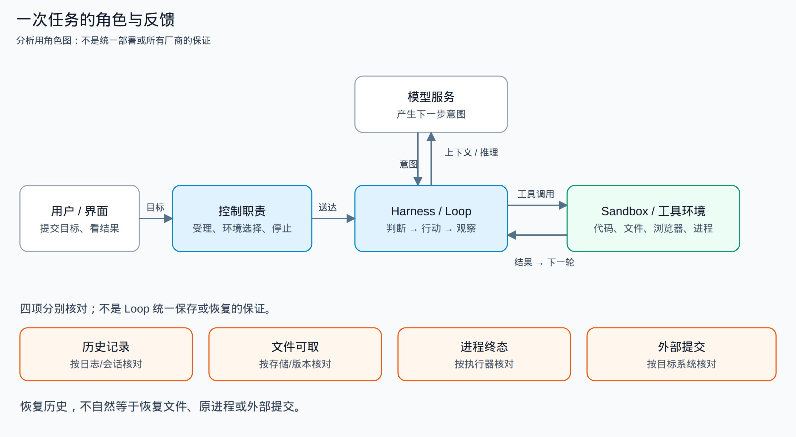
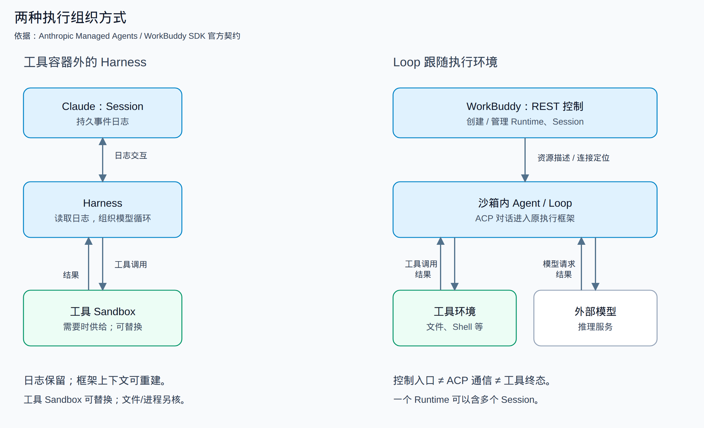
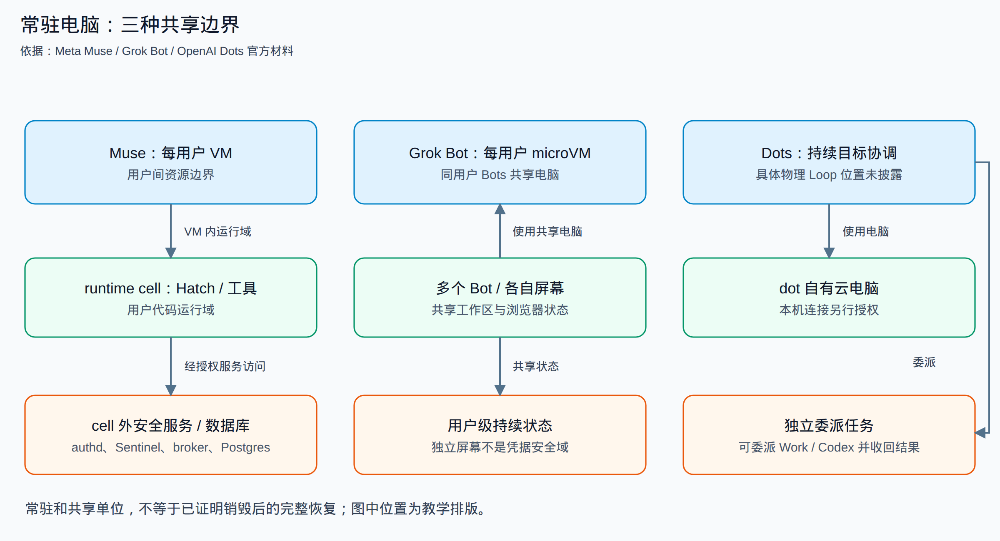

# 云端 Agent 的架构：谁在思考，谁在执行，状态留在哪里

把代码库交给 Agent，关掉浏览器，几分钟后再回来检查修改——这件事已经不只是一次聊天。后台必须记住你交付了什么，把任务送到一处能够运行代码的环境，并在执行结果回来后继续判断。要是环境退出，它还得决定：重建电脑、继续会话，还是明确告诉你这次工作已经中断。

不同产品都可以给出类似的界面，却没有相同的内部结构。Claude Managed Agents 把会话日志、执行框架和工具沙箱分成三层；WorkBuddy 用 REST 管运行资源，用 ACP 与沙箱内的 Agent 对话；Muse、Grok Bot 和 OpenAI Dots 则把跨任务保留的电脑放到了产品中心。这个差别决定了什么可以共享、什么需要重建，以及停止按钮到底停止了哪一部分。

本文比较 Kimi、Claude、Codex、DeepSeek、阿里千问及 AgentRun、腾讯 WorkBuddy、Manus、Meta Muse、Grok Bot 和 OpenAI Dots。资料核对时间为 **2026 年 10 月 12—13 日**。其中“Grok dots”未查到可确认的正式别名，以下按官方名称 **Grok Bot** 研究；Muse 指 Meta 的个人 Agent，而不是同名模型或视频服务。

本文面向正在搭建或接入异步 Agent 服务的工程师，重点纠正一种误判：聊天、Sandbox 和 cancel/resume 接口齐全，不等于任务已具备完整执行与恢复能力。

我们结合官方架构说明、公开客户端与 SDK、第三方历史观察，以及 REA 对本机取得制品的分析。它们支持的是不同层次的认识：官方文档说明产品契约，客户端显示请求与本地判断，受控实验验证有限运行路径；没有取得的闭源云后台不会用猜测补齐。全文图源与每条依据的范围放在文末。

## 一次任务怎样完成

先把三个容易混在一起的角色分开。

**模型负责产生下一步意图。** 它读取目标、历史和工具结果，可能选择修改文件、运行测试、查网页，也可能直接结束。模型本身不会因为返回了一个工具调用，就自动拥有文件系统或浏览器。

**Harness 负责把判断变成连续工作。** 这里的 Harness 指执行框架：组织上下文、请求模型、解释工具调用、等待结果，再把结果放进下一轮。本文把这段“判断—行动—观察”的循环简称为 Loop。它既可以在工具环境里，也可以在环境外；推理服务还可能位于另一套基础设施。

**Sandbox 提供实际操作的环境。** 文件、Shell、浏览器、软件依赖和运行进程在这里。Sandbox 是环境角色，不是固定技术名称：产品可以用容器、microVM、完整 VM，或者对本机进程施加限制。只有知道它隔离的是谁与谁，才知道“有沙箱”意味着什么。

从用户提交目标到收到产物，还需要两个方向的协作：一边受理任务、选择或创建环境、记录状态、处理停止和回收，这是控制面；另一边传递对话、工具调用、输出流和文件，这是执行与数据路径。两组 API 分开，未必就运行在两组服务里；两个服务分开，也未必构成两个安全域。

图中最重要的不是模块数量，而是闭环：**工具结果必须回到下一轮判断，产物与状态必须有明确去处。** 实现一个“创建沙箱”接口，只解决了工具有地方运行；实现一个“查询任务”接口，只解决了用户有地方看状态。它们之间仍需要执行框架接线。

再看“恢复”。重新打开界面能看到历史，说明消息被保存；下载到上次生成的文件，说明文件仍可取；继续运行上次启动的服务器，需要进程状态；确定上次付款没有重复发生，则需要业务效果的对账。这是四种不同的承诺，不能用一个 `resume` 字段全部代替。

例如，历史可见、文件可下载、新环境 ready，仍不等于原任务可以安全重跑。若旧工具终态和此前 Git push 的远端结果未知，应先核对，再决定哪些步骤继续或重放；这是设计判断，不是本文已经在各家云端完成的对账实验。

## Claude：把会话、脑和手分别替换

### Managed Agents 的三层分离

Anthropic 的 [Managed Agents 架构说明](https://www.anthropic.com/engineering/managed-agents)把 Session、Harness、Sandbox 明确拆开。Session 是持久事件日志，记录消息和行动；Harness 读取日志、组织模型循环；工具需要环境时，才供给 Sandbox。Harness 在代码执行容器外。

这使故障不必沿同一边界扩大。Harness 退出，可以让另一份 Harness 从 Session 事件重新建立上下文；工具容器失败，可以把失败作为一次工具结果返回，再由模型决定怎样继续。它不要求为了重启“脑”同时恢复原来的“手”，也不要求会话存在期间一直占着同一个工具环境。

但拆开并非免费：框架必须把工具输入、结果与会话事件关联起来，还要处理环境丢失后的文件供给。事件日志能重建对话上下文，不会自动重建工具进程，更不会撤销已经发出的外部请求。这里的价值是**让不同状态可以分别管理**，不是把所有恢复问题一次解决。

一个假设的提交窗口能说明限制：工具已经 Git push 成功，结果却尚未进入持久日志时，Harness 退出。新 Harness 从日志重建上下文，也无法仅凭日志确定远端结果和旧工具终态。公开材料没有披露把这种外部提交与日志记录原子关联的协议，不能因此保证该步骤安全重放。

凭据也沿这一结构分离，但 Git 与 MCP 是两条路径。官方说明中，Git 的仓库访问 token 在初始化时用于 clone，并接入本地 remote，让沙箱内 push/pull 不需要 Agent 自行处理 token；MCP 的 OAuth token 则存于沙箱外 Vault，专用代理依据 Session 关联取得凭据并调用外部服务。Harness 不拿到真实凭据，但不能把两条路径都画成同一个 MCP 代理，也不能扩大成所有网络请求采用相同过滤。

### Claude Code cloud 是另一种路径

[Claude Code cloud environments](https://code.claude.com/docs/en/cloud-environments)以 Session VM 提供执行环境。环境配置负责仓库、初始化脚本、网络和秘密。VM 可以空闲暂停，也可能被回收后重建；初始化文件缓存是准备优化，不是正在运行的所有进程的检查点。

截至本次核读，network secret 适用于 Pro／Max 的 Anthropic 托管环境，不适用于自托管环境：VM 外 agent proxy 按目标主机附加凭据。GitHub 使用另一专用 proxy；setup 在 agent proxy 启动前执行，Anthropic API、公共包仓库与 telemetry export 也不接收这种 secret。普通变量进入命令环境后可以被命令读取，不能因 network secret 使用代理，就认为两者有相同边界。

GitHub proxy 的官方契约还有资源限制：API 请求限于 Session 附属仓库，拒绝分支删除和非分支 push；它不限制 push 更新哪条分支，具体保护要依赖 GitHub 规则。这是官方描述，不是本轮完成的动态授权测试，也不同于仅按主机附加的 network secret。

[自托管模式](https://code.claude.com/docs/en/self-hosted-environments)又把执行搬到组织管理的主机：Anthropic 控制面保留会话与队列，Runner 出站轮询、领取租约，再启动 Claude Code 子进程。它适合把仓库和执行留在组织网络内；相应地，主机权限、容量和本地文件保护也由部署方承担。同一个 owner 下多 Session，并不自然形成文件硬隔离。

我们取得固定 **2.1.296** 的原发布 Runner，在无外网的研究命名空间里实际启动，使用合成控制服务和 Python 子进程，观察到登记、轮询、worker epoch、FD3 活动和停止路径。取消分配、启动超时、drain 与 epoch 拒绝按有限场景运行。另用合成秘密确认两项父进程环境变量没有传给子进程，但同用户可读的合成秘密文件仍能被子进程读取。

这补到了**原 Runner 的本机监督机制**，没有运行真实 Claude Loop、Anthropic 租约服务或产品 VM。研究中外加的 bwrap 是实验约束，不是 Runner 自建的产品 Sandbox；本机变量过滤也不是整台主机的凭据隔离。

## Codex 和 WorkBuddy：环境复用不等于任务共享

### Codex Cloud：复用准备，隔离工作区

[Codex Cloud](https://help.openai.com/en/articles/20001545-using-codex-cloud)把发布的 Environment 与每次任务的工作区分开。用户选择仓库和环境配置，任务在独立工作区处理代码；浏览器关闭后，云任务仍可继续。

[环境文档](https://developers.openai.com/codex/cloud/environments/)区分准备阶段和 Agent 阶段。准备阶段可以联网安装依赖；setup secrets 在进入 Agent 阶段前移除。Agent 网络默认关闭，也可以配置联网范围。环境缓存用于减少重复初始化，恢复时可以运行 maintenance，而不是承诺永久保留原任务的每个进程。

这里真正可复用的是“怎样准备一处工作环境”以及可缓存的准备结果，不是让不同任务必然写同一份活工作区。模型 API、环境内命令与用户看到的任务结果仍需由执行框架组织；官方资料没有给出完整云队列、worker 租约或 Loop 相对容器的进程拓扑。

公开 [Codex 0.153.0 源码](https://github.com/openai/codex/tree/41e22fee981a63b3698df7ed36bad393cda24715)可以核对客户端任务接口和执行库。我们对对应原 ELF 做了受限 REA 函数分析，并实际运行原 `exec-server`：观察单连接占用、同一存活服务重新连接、执行终止、脱离连接后的有界保留，以及指定写入 ID 的重复处理。

这些结果解释了一种本机执行器怎样管理连接与子进程。它没有经过完整 core 入口，没有请求产品 OS Sandbox，更没有证明 Codex Cloud worker 使用同样实现。原生分析也保留了超时、函数范围与不返回假设的限制，不把反编译伪代码当原始源码。

### WorkBuddy：REST 管资源，ACP 进入 Loop

腾讯 [WorkBuddy SDK 文档](https://www.codebuddy.cn/apiDocs/cloud-agent-sdk-api-Node%20SDK.md)明确区分两条路径：REST 创建和管理 Runtime、Session 等资源；ACP 连接 Runtime 中的 Agent，完成对话与流式结果。Agent 在沙箱内运行，再向外部模型服务请求推理。

Runtime 是独立 Linux 沙箱，可以容纳多个 Session。Session 区分对话上下文；是否共享文件，仍要看 Runtime 和工作区的组织。调度器可以复用 Runtime，再创建新的 Session；[AgentOS API](https://www.codebuddy.cn/apiDocs/agentos-api.yaml)还提供 Checkpoint、Version 与恢复操作。接口提供恢复能力，不代表快照一定含全部进程内存，也不代表会回滚外部系统。

这条模式容易直接使用现有 CLI：资源控制面可以复用已有执行框架，再把通信接到执行端。但平台仍要承担任务受理、资源绑定、身份与凭据、版本适配、停止回收和故障处理，ACP 接通不代替这些责任。代价是两种状态必须协调——“Runtime 已创建”不等于“ACP 已连通”，ACP 连通不等于一次 prompt 已执行完毕。REST 认证、ACP token 和模型 key 也是不同用途的凭据。

所读 SDK 文档标注 0.3.4，而本机取得的发布 SDK 为 0.3.8；两者不作为同版本验收。我们以固定 **SDK 0.3.8 → CodeBuddy 2.164.0 原 headless ACP → 原 Loop** 在本机接通，模型与 Runtime 控制描述使用合成服务。原 Loop 完成一个本地 Read，文件内容以同一工具调用结果回到模型请求。这个正常样本由同 Session／conversation 的请求、原 Read 完成日志和同 tool_call_id 的文件正文回传人工交叉核对；自动关联断言尚不完整，topic-only、wrong-call 与 late-error 负例未运行。随后另一次仅模型持续流的 prompt 收到 cancel，流连接关闭，SDK 返回 cancelled。原 SDK 直接连接还遇到公开客户端 marker 检查，显式 custom fetch 加 marker 后才进入该链路。

官方契约与固定版本本机机制分别成立，本轮未确认 WorkBuddy 云端采用这一版本和启动组合。这个实验不是 WorkBuddy 云部署复现：Runtime 描述是合成的，原进程的 SandboxPolicy 本例关闭，外层隔离是研究约束。Read 在取消前已经完成，不能用随后模型流的取消证明有副作用工具、子任务或远端计算全部停止。它补充证明了**这组固定版本在明确适配后接通原 ACP、Loop 与本地 Read 回路**，不只是看见接口名字；不能据此推出所有执行框架必须采用 ACP。

## Manus：临时任务电脑与常驻电脑各管一类工作

Manus 的 [context engineering 文章](https://manus.im/blog/Context-Engineering-for-AI-Agents-Lessons-from-Building-Manus)描述 action—observation 循环和文件外置上下文：模型采取动作，环境返回观察，下一轮继续判断；长材料可以留在文件中，需要时再读取。

默认 Task 使用临时 Sandbox。官方 [Sandbox reset 说明](https://help.manus.im/en/articles/11711144-what-can-i-do-if-i-encounter-a-sandbox-issue-in-the-task)指出，重置可能丢失沙箱文件，而会话历史仍保留。另一产品 [Cloud Computer](https://help.manus.im/en/articles/15392111-what-is-the-cloud-computer)则是一台跨任务使用的常驻 Ubuntu 电脑，保留文件和安装工具，适合连续工作。两者不是相同资源套上两个名称。

这区别回答了一个实际问题：如果任务只是生成一份交付文件，环境可以在交付后回收；如果要持续维护网站、保留软件和工作目录，电脑本身也成为用户资产。常驻减少重复准备，却要承担长期容量、状态更新与恢复管理。

公开客户端中，我们追到 Sandbox REST，以及 Socket.IO 连接、Session 重加入、事件游标和独立作业的 start/stop 响应匹配。离线回放能核对某条响应是否与请求对象匹配，不能认证后台已经执行该动作。消息重新加入解决的是**重新看见进展**，不是重建已丢失的电脑。

[Task 生命周期](https://open.manus.ai/docs/v2/task-lifecycle.md)与后台作业也应分别观察：主 Agent 停止后，不能只凭主状态推定所有背景作业结束。至于具体 VM 栈，E2B 有 [2025 年 5 月的客户披露](https://e2b.dev/blog/how-manus-uses-e2b-to-provide-agents-with-virtual-computers)，这是供应方历史依据，不足以覆盖 2026 年所有 Manus 环境。

## Muse、Grok Bot、Dots：电脑变成持续工作的一部分

与一次任务的临时工作区相比，持续 Agent 要处理跨天目标、登录状态和用户自己的应用。常驻电脑让这些状态有了归属，但三家的共享和授权单位不同。

### Muse：VM 里面仍然需要安全分域

Meta 的 [Muse 安全架构](https://research.meta.ai/blog/security-and-safety-for-ai-agents-our-approach-with-muse)给每用户专属 Linux VM，Hatch 在 systemd-nspawn runtime cell 中运行用户工具；authd、Sentinel、Postgres 和 CDP broker 等服务位于 cell 外。

为什么已有 VM 还要分内外？VM 隔开的是不同用户，cell 进一步把模型可运行的代码与凭据、授权服务分开。工具可以请求访问应用，却不必直接拿到真实 OAuth 凭据。Sentinel 对具体网络请求作授权判断，再将 surrogate 替换为真实凭据；浏览器通过 broker，特权操作通过 privsep。这不是给工具一个能访问所有账户的永久通行证，而是把授权判断保留在另一安全域。

Postgres 的 durable app state、workspace 和 credential store 也不是同一份状态。VM 常驻并不能推成主机销毁后原子恢复，官方文章没有给出完整快照一致性与 RPO。Confidential VM 在该发布材料中属于计划，不能写成已部署保证。

第三方有 [Muse Architecture Tour](https://gist.github.com/juleskuehn/480139a0ea9509e9b085459a045e03dd)，另有非官方社区快照。我们对快照中的 execd 做 REA namespace 分派分析：原表项和指令提供了有限 helper 调用线索，未执行内核切换。快照摘要一致不认证 Meta 发布主体，这部分只作实现线索，不提升官方安全结论。

### Grok Bot：多个 Bot 共享的是同一用户电脑

[Grok Bot 官方文档](https://docs.x.ai/grok-bot/security-faq)说明，每用户有持久 Firecracker microVM，同用户的 Bots 共享这台电脑。[Computer and apps](https://docs.x.ai/grok-bot/computer-and-apps)进一步区分共享工作区、浏览器与各自屏幕。

独立屏幕方便不同 Bot 同时操作，但屏幕不是凭据安全域。一个 Bot 的浏览器登录和命令行凭据可能供同账号其他 Bots 使用。这一设计按用户复用准备好的电脑，不按每个 Bot 重做完整登录与工作区；代价是不能把 Bot 当成互不信任的租户边界。

文档也区分正常更新中的保留状态与从保存 snapshot 的 Reset，最近变化可能丢失。OAuth connector backend 与浏览器内会话是不同凭据路径。本机电脑连接另行授权，不能把云 microVM 的边界套给本地执行。

固定 0.70.2 桌面制品中可见云控制、Box gateway 条件路由与本机桥接。内部 coordinator、harness 或 temporal 标签能帮助找到客户端职责，却不能确认主 Loop 的云部署位置或中央工作流采用哪套实现。

### OpenAI Dots：持续目标可以委派独立任务

[Dots 的电脑与应用说明](https://learn.chatgpt.com/docs/dots/computers-and-apps)把 dot 自有云电脑、本机连接、cloud threads 和 Codex 委派分开。持续目标不需要和所有子任务共用一个活工作区；可以保留协调上下文，把具体工作交给独立任务，再收回结果。

[隐私与安全说明](https://help.openai.com/en/articles/20001529-dots-privacy-security-and-safety-faqs)还把主动研究的只读权限、执行动作的规则和 private sign-in 区分开。登录时模型暂停，让凭据直接进入浏览器，是一个特定交互路径；它不是宣称常驻电脑里的所有历史信息都对工具不可读。

App 授权与 ChatGPT、Work、Codex 的关系，以及 dot context、Memory、Library 文件和 Codex threads 的保留，要按各自对象理解。删除 dot 不等于删除已经生成的所有产物。取得的 ChatGPT **26.1007.30912** 包可静态核对 dot 控制、本机 executor 和消息续接。其字节与内部签名一致不等于独立认证发布主体或线上启用，官方产品说明另有来源；而同包内部 aeon、durable 或 Codex 名称，不足以证明云服务共置。具体 hypervisor、Loop 位置和快照回收策略仍未披露。

## Kimi、千问、DeepSeek：先分清消费产品与基础设施

这三家最容易出现一种研究误差：找到同厂商的 SDK、开源训练平台或文件系统，就把它们接到消费端产品后面。它们都提供有价值的机制依据，但“同厂商”不是部署链路。

### Kimi：对话、产物、环境是不同对象

[Kimi Agent](https://www.kimi.com/en/help/agent/agent-overview)支持云端后台执行，[Swarm](https://www.kimi.com/en/help/agent/agent-swarm)描述委派和独立上下文。前端原模块可读到 Goal 管理，ChatService 的流、续接与取消，以及 Build App、preview、database、storage 和 secret 的具体调用。

这说明用户看到的不只有一条聊天流，还包括可以独立查询、编辑或发布的产物资源。`appId`、资源 ID、版本和文件引用各有职责：拿到预览 URL 不等于拿到了 task Sandbox 的完整身份，重新订阅聊天也不等于恢复工具进程。协议里有 `EnsureEnvironment(preset, chat_id, agent_id, ttl)` 与文件版本／etag，但本轮没有追到对应真实调用方和后台供给，不能把字段解释成已验证的环境基数、TTL 或恢复保证。

另两组材料能补充存储，却必须分别看。

第一组是 [第三方 Kimi 沙箱报告](https://github.com/agent-infra-foundation/agent-infra-book/blob/ecf3037b1bd70039be8ec36a48440a855b054f26/sandbox/kimi/Kimi%E6%B2%99%E7%AE%B1%E7%BB%BC%E5%90%88%E6%8A%80%E6%9C%AF%E6%8A%A5%E5%91%8A.md)，作者自述观察于 **2026 年 8 月 11—12 日**。它报告了容器工作区、根 overlay 与 `/mnt/agents` 的 `fuse.portal` 挂载，以及若干文件操作现象。具体实验执行者、独立实例和会话数量未提供；译稿与合并稿不是独立复测。这是历史作者报告，不是本机 REA 实测。

挂载中的 `user_id=0` 是 [FUSE mount owner](https://docs.kernel.org/filesystems/fuse/fuse.html)，不证明 daemon 当前身份或宿主 root；可见进程表里没找到 daemon，也不能定位它必在 host 或 sidecar。短 `fsync` 返回不能说明异步上传或远端耐久。文件工作区线索很有价值，但不能从几条字段推成完整存储服务。

第二组是 PingCAP CTO Ed Huang 于 **2026 年 5 月 14 日**发表的 [Kimi K2.6 建站数据库披露](https://www.pingcap.com/blog/agent-database-kimi-k2-6/)。它描述每租户逻辑完整的数据库视图，底层共享分布式 KV 和对象存储，**没有每租户专属物理数据库实例**。建站代码生成之后，网站及数据库仍需要服务，这与 Agent 的一次生成过程是不同职责；两者具体生命周期绑定未完整披露。

这不是 `FUSE → TiDB` 的接线证明。五月建站数据库与八月工具文件挂载没有共同部署、任务或会话标识；供应方的成本和供给数字也没有在本轮独立评测。Kimi Claw 的专属 OpenClaw 环境、Kimi Work 的本地 Goal，以及 [AgentENV 训练平台](https://github.com/kvcache-ai/AgentENV/tree/49684233698d40dd800c1d0edba15ab30a745eeb)各自有依据，不代填普通消费端 Swarm 后台。

### 千问与 AgentRun：消费请求可见，平台机制另算

千问消费端固定 4.9.6 原模块可追到任务 HTTP 请求、查询／取消和 RMB worker 通知。通知到达后补查任务，是为了让页面取得最新状态；ACK 和消息游标不是任务成功或执行恢复的证明。Loop、工具 worker、环境供给、凭据代理与生产授权仍没有从这些客户端中还原。

[千问 AI Managed Agents](https://platform.qianwenai.com/docs/agent-infra/managed-agents/introduction)则公开 Agent、Environment、Session、Event 的平台契约；[独立 Sandbox 服务](https://platform.qianwenai.com/docs/agent-infra/sandbox)描述 template 创建、暂停保留文件与内存、恢复与释放。[阿里云 AgentRun](https://help.aliyun.com/zh/agentrun/what-is-agentrun)是另一平台产品，涉及运行、网络、存储与治理。这些可以用于理解供给方式，不能在没有关联证据时画成千问消费端的底层。

原 AgentRun SDK 中，管理端创建／获取／停止资源，数据端调用资源 endpoint；应用 HTTP handler 再通过模型或 Sandbox 工具组织执行。资源 ID、访问 token 和 endpoint 要与具体请求关联。受控回放还显示一个关键区别：HTTP 请求断开不必然停止一个未使用 signal 的应用 callback；重新创建资源并 retry，也没有自动对账旧调用的外部效果。这里是在指定输入上的 SDK 机制观察，不是阿里生产事故。

### DeepSeek：模型调用、DSH 和 DSec 不能合成一个网页后台

[DeepSeek Tool Calls](https://api-docs.deepseek.com/guides/tool_calls/)返回工具意图，函数由调用方执行。公开 [DeepSeek Harness](https://github.com/deepseek-ai/deepseek-harness)的 DSH 是本机执行框架，包含进程约束、文件写入与日志；它不因此成为 DeepSeek 网页的用户云电脑。本轮当前聊天入口采集受限，历史前端也不用于认证当前部署。

真正有完整基础设施披露的是训练／评测场景的 [DSec 论文](https://arxiv.org/abs/2609.22978)，版本日期 **2026 年 9 月 19 日**。它组织管理服务、placement、节点运行时与多种 Sandbox backend，使用 3FS backing 和本地写层，让大量训练环境可准备、暂停和复用。GPU trainer 与环境执行职责分离，论文所述 V4.1 worker container 加 Agent Sandbox 在 GPU pool 外，但不是把每个 Agent Loop 都移到 Sandbox 外。

其暂停／恢复包含不同 backend 的处理：容器冻结，或 microVM 内存 snapshot、结束 Firecracker 后再 resume；增量磁盘环境又是另一层状态。论文描述的 trainer 抢占重连，不足以保证 worker 或节点丢失后所有工具副作用恢复。评测范围也没有独立认证每项集成恢复机制。DSec 适合比较训练基础设施，不适合补画消费网页。

可借鉴的原则是把任务权威状态与可抢占计算分开，但 GPU pool 外不等于故障节点外。企业仓库任务换节点续跑，还须确认节点外的一致恢复点、新旧执行者与任务代际绑定、旧权限及在途请求约束，并核对未决的 Git push。这些是迁移前提，不能由共享镜像、snapshot 方法或正常 pause/resume 认定已经满足。

## 怎样把这些差异用于自己的设计

先把主要差异压到一张表。表中“未知”是研究范围内未确认，不是产品不存在或不安全。

| 对象 | 控制与 Loop | 环境／共享单位 | 状态的关键边界 |
| --- | --- | --- | --- |
| Claude Managed Agents | 日志、Harness、Sandbox 分离；Harness 在工具容器外 | 工具按需供给 | 会话可重建，不自动恢复文件与副作用 |
| Claude Code cloud／自托管 | 托管 Session VM；自托管控制队列 → Runner → 子进程 | Session／组织主机；同 owner 可多 Session | VM 重建、会话历史、本地文件分别处理 |
| Codex Cloud | 独立任务；完整云 Loop 拓扑未知 | Environment 配置复用，任务工作区独立 | setup 缓存不是进程检查点 |
| WorkBuddy | REST 管资源，ACP 进入沙箱内 Loop | Runtime 可含多 Session | 上下文隔开不等文件隔开 |
| Manus | 异步 Task 与工具观察；物理 Loop 位置未知 | 临时 Sandbox／常驻电脑分开 | reset 可丢文件，历史仍保留 |
| Meta Muse | 用户 VM 内 cell 与 host 安全服务分域 | 每用户 VM | workspace、数据库、凭据分别管理 |
| Grok Bot | 云电脑与本机连接分开；云 Loop 位置未知 | 同用户 Bots 共享 microVM | 屏幕不是安全域，reset 可回退 |
| OpenAI Dots | 持续目标可委派独立任务；物理部署未知 | dot 自有电脑与委派工作区 | context、文件、threads 不同对象 |
| Kimi／千问消费端 | 客户端控制与结果流已见；后台部署未知 | 不能由协议字段推定 | 消息续接、产物版本、环境恢复分开 |
| 千问 AI／AgentRun | 平台契约与 SDK 接线 | 独立托管环境／资源 | pause、release 与业务恢复不同 |
| DeepSeek DSH／DSec | 本机框架／训练管理与运行时分别研究 | 本机进程／训练 Sandbox | 本地日志、环境快照与消费端无直接等同 |

针对同一个异步仓库任务，若服务端进程可以脱离浏览器持续工作，日志和目录可保留，并允许故障后核对结果再重建，“单个执行进程＋持久任务日志＋独立工作目录”可以作为简单基线，不必先拆服务。它仍需确认停止和外部提交，目录也不是完整安全隔离。只有确实需要分别替换框架与工具环境、独立管理生命周期，或远程供给及复用多个 Runtime，新增分层才有具体用途。

这里没有一个通用的“最好架构”。如果执行框架能把工具当远程能力调用，三层拆分便于独立替换和按需供给，但要承担事件、文件与结果关联；如果复用成熟 CLI，像 WorkBuddy 那样让 Loop 跟随执行环境，接线更直接，但必须把资源控制状态与通信状态分开。若用户需要持续登录和跨天工作，常驻电脑有明确价值；若只是短任务交付，长期占用与状态维护的收益则需要另算。这是依据机制作出的设计分析，不是厂商间性能或成本评测。

对一个自己的 Agent 平台，最值得先明确的是三个边界。

**第一，Session 绑定哪一层资源。** 它是一段日志、一份工作目录、一台电脑，还是三者的关系？复用 Runtime 时，如果不同 Session 的工具在同一文件树工作，就不能只凭对话 ID 宣称隔离。

**第二，哪类凭据需要进入执行环境。** setup secret、模型 key、OAuth 代理和浏览器登录不能用同一个“支持 secrets”承诺概括。允许访问 Git 域名、由代理附加凭据且秘密未进入执行端，并不足以证明某次仓库写入得到任务授权。凭据保密、网络可达、动作授权是三个边界：主体、任务、目标资源和动作的权限关系仍须另行核验。代理在环境外可以减少真实凭据暴露，但仍要把资源归属、目的地与动作权限绑定到每次访问；用户级共享电脑则需要接受同用户工具共用状态的边界。

**第三，停止和恢复承诺到哪一步。** 停止接收新 prompt、关闭流、结束 Loop、终止工具子进程、停止背景任务、对账外部提交，必须有分别可查的结果。恢复同样先分历史、文件、进程和业务效果，再决定是 resume、重建还是告知用户重新执行。

在仓库任务的例子里，判断也应按步骤进行，不是一律重跑或停住整件工作。先核对文件版本、恢复目录、权限和命令的实际行为，独立目录中已确认无未决外写或共享冲突的步骤才可继续；“读取”“编译”的名称本身不能保证无副作用。再取得绑定原任务／代际的旧工具终态，或核验覆盖相关凭据与在途写请求的旧执行约束。最后，对 push 单独查可关联本次请求、仓库、ref 与提交内容的权威记录：确认成功就跳过，确认未生效且排除冲突才重试，缺证则只保留这一步未决。旧工具停止不撤销此前提交，旧写入约束不证明过去请求失败。远端当前分支不是该次请求的因果收据，业务去重只按其耐久契约覆盖相应操作，也不能代替恢复状态、授权或旧执行约束。这些是验证建议，不是各厂商已经实现的保证。

下面是一组**设计验收建议，不是本轮已在各厂商云端执行的实验**：断开界面后查询原任务；停止时同时观察主 Loop 与工具；回收环境后核对历史、文件和进程；让一次外部写入在响应前断开，重新连接后检查是否重复。它们比检查 SDK 是否存在一个 cancel 或 snapshot 方法，更接近用户实际依赖的承诺。

## REA 提供了什么，以及图源在哪里

本轮先检索 REA 官方仓库与 showcase，未取得针对上述全部云 Agent 的现成 REA 架构报告。可参考的 [Notion 桌面案例](https://rea.tools/showcase/notion/)追踪 page API、preload、IPC 和 main 的剪贴板边界；它展示的是跨应用边界取证方法，不是闭源服务端还原。Muse 和 Kimi 有第三方观察材料，但不能改称 REA 报告。

随后我们取得公开 JS、SDK 和原生制品，用 REA 分析选定原函数／模块，配合独立字段解码和有界本机实验。**“下载过 → 解析过 → 原函数运行过 → 云任务运行过”是不同阶段。** 这轮没有使用用户真实凭据、付费云任务或登录绕过，也没有通过公开客户端推造后台队列。

读者可下载 [29 页组件图集](https://saltadamw.github.io/blog/assets/cloud-agents-2026-10/components/all-graphs.drawio) 与 [23 页生命周期图集](https://saltadamw.github.io/blog/assets/cloud-agents-2026-10/lifecycles/all-graphs.drawio)，或下载 [逐图目录](https://saltadamw.github.io/blog/assets/cloud-agents-2026-10/atlas.md)，选择各产品的 SVG 和独立 draw.io。图中的官方契约、客户端静态观察、本机受控结果、第三方历史报告与未知使用不同标注；图的泳道归类是分析整理，不是生产拓扑认证。正文三张简图用于讲解，完整图集保留更多连接与限制，适合放大查看。

[公开来源与阅读范围](https://saltadamw.github.io/blog/cloud-agent-architecture-2026-10.sources.json)保存原作链接、版本、日期和证据等级；[有限实验摘要](https://saltadamw.github.io/blog/assets/cloud-agents-2026-10/evidence-summary.json)记录实际运行范围与未完成项。原二进制、运行日志、模型请求和凭据不随稿公开。

最重要的结论不是某家用了哪一种 VM，而是：**会话、执行环境、授权和业务结果分别需要自己的归属与生命周期。** 理清这些关系，才知道一处故障应当替换哪个组件，停止按钮该等待谁，以及恢复后用户到底能继续什么。
